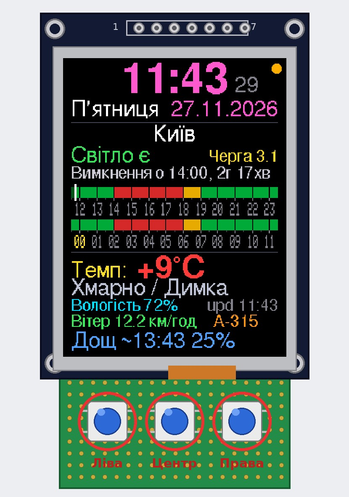
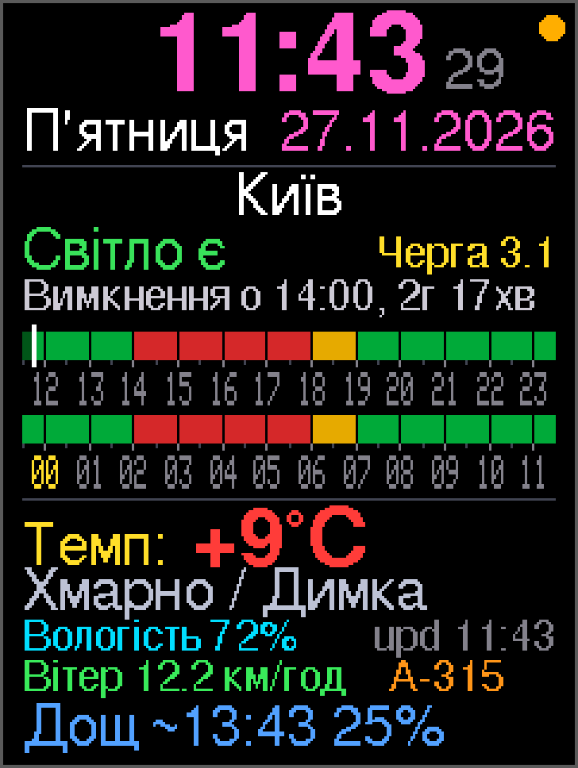
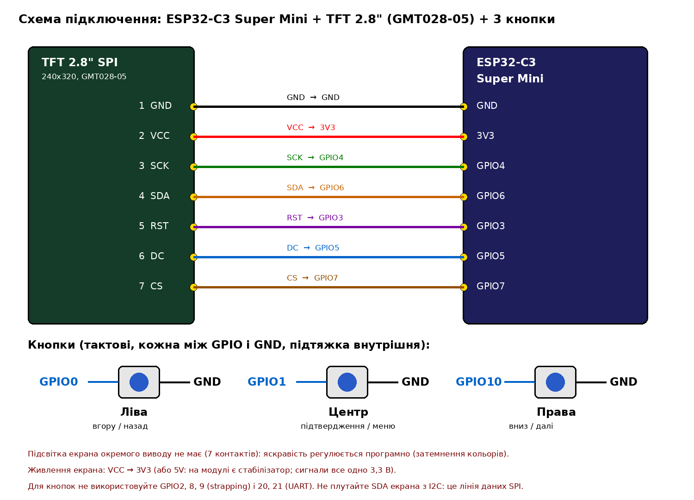
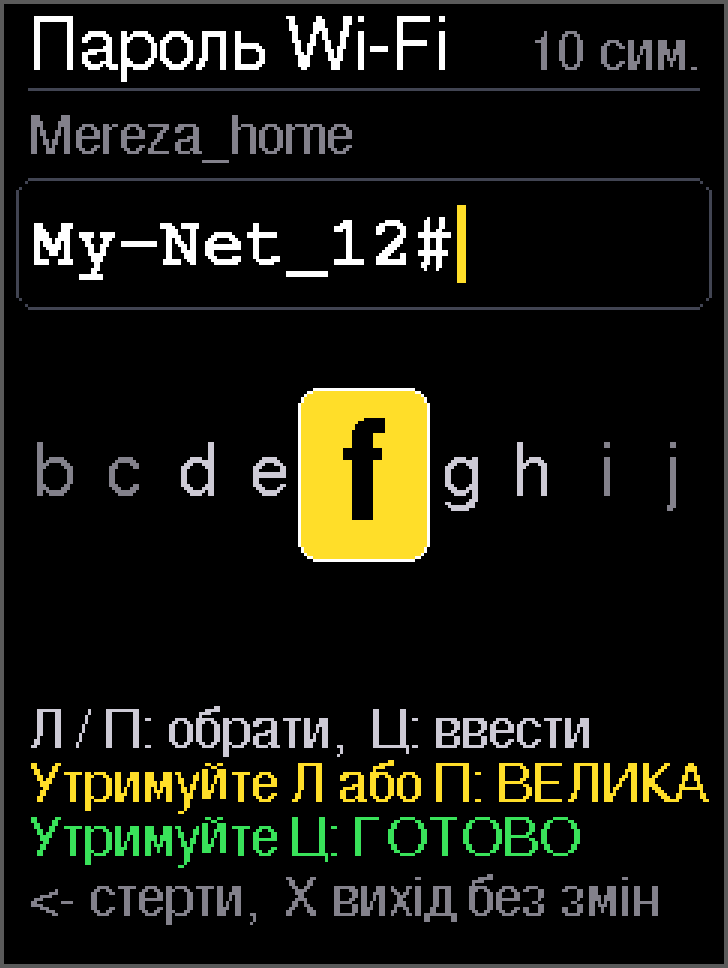
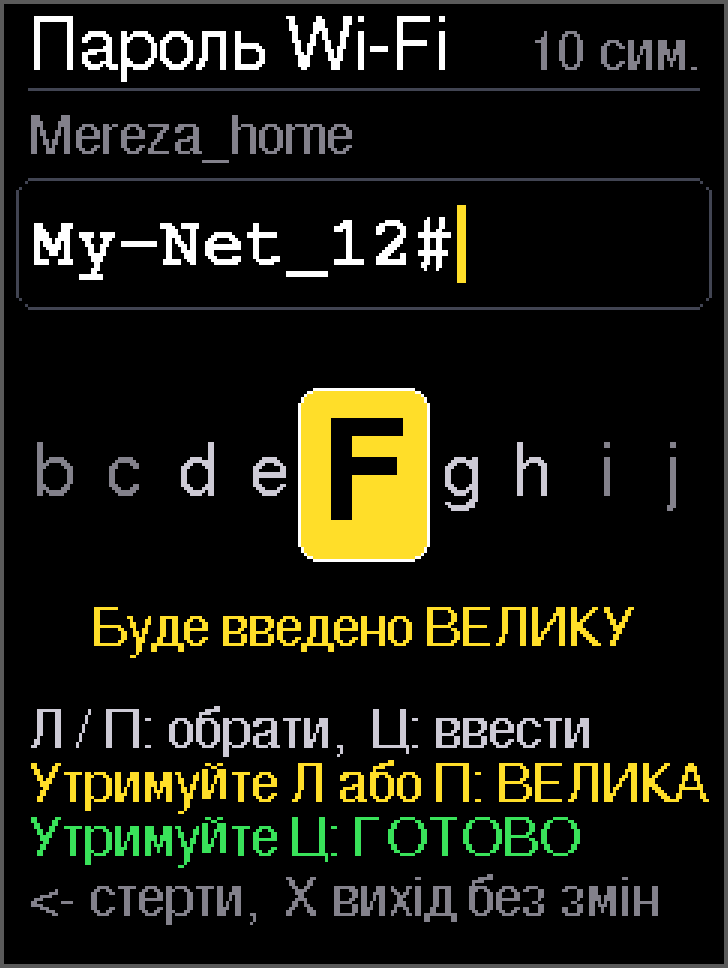
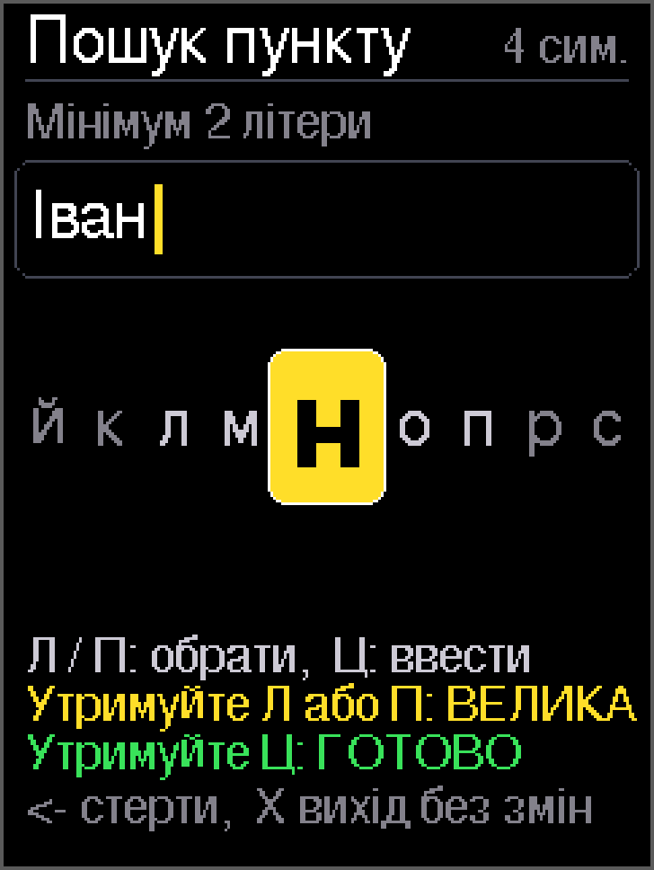
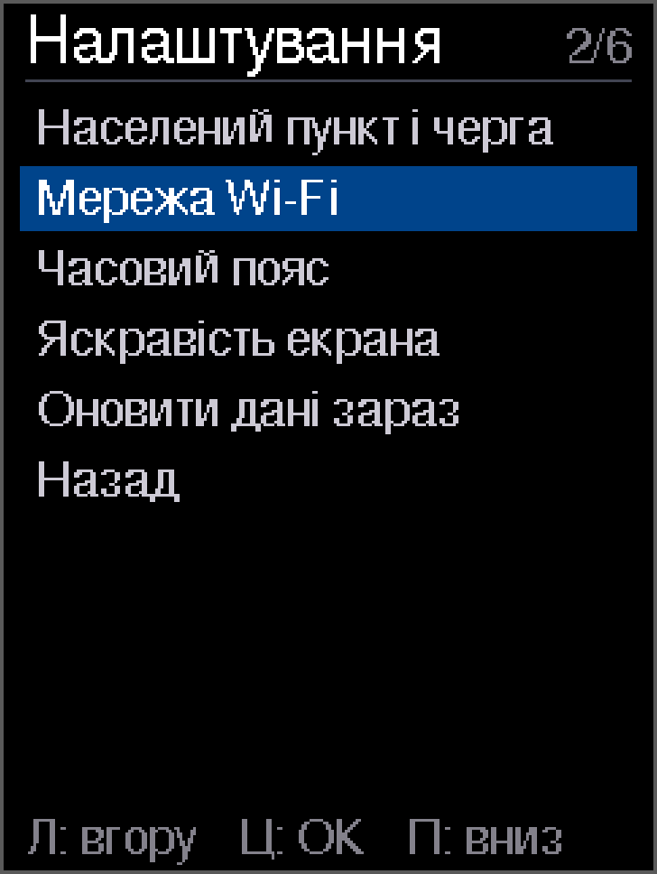
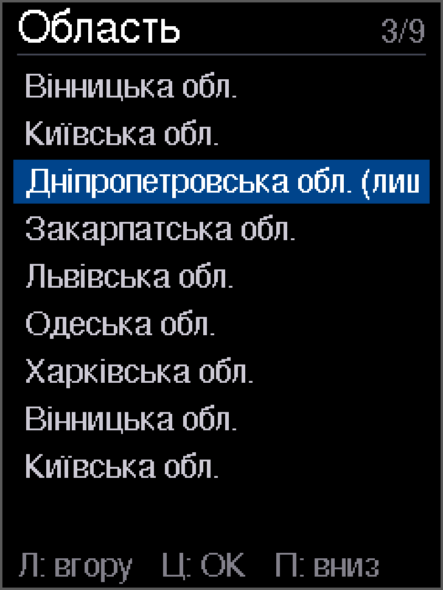
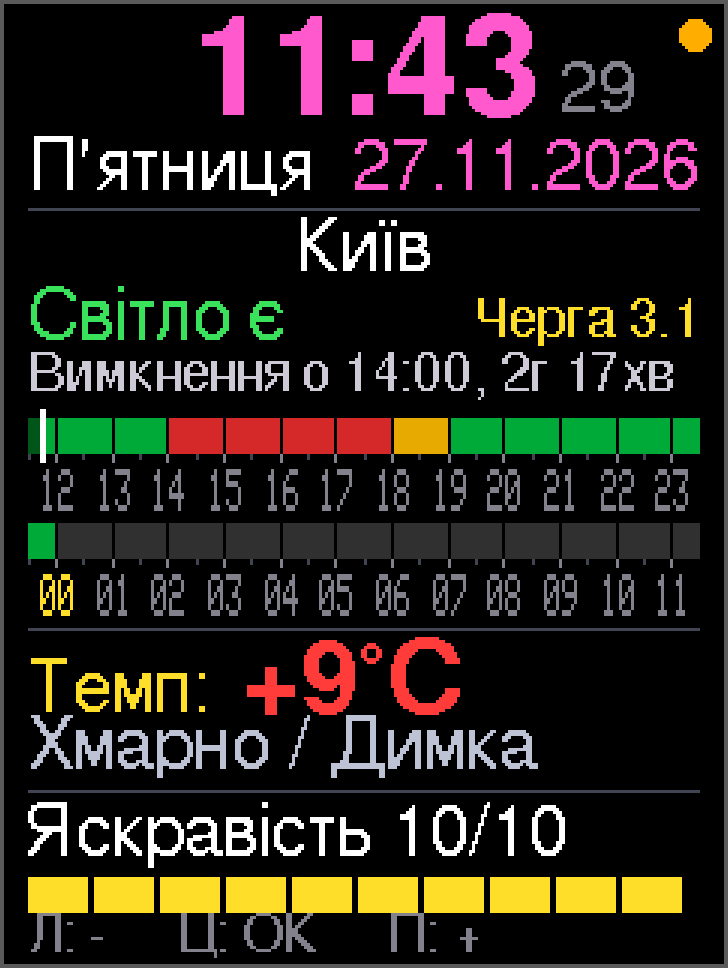
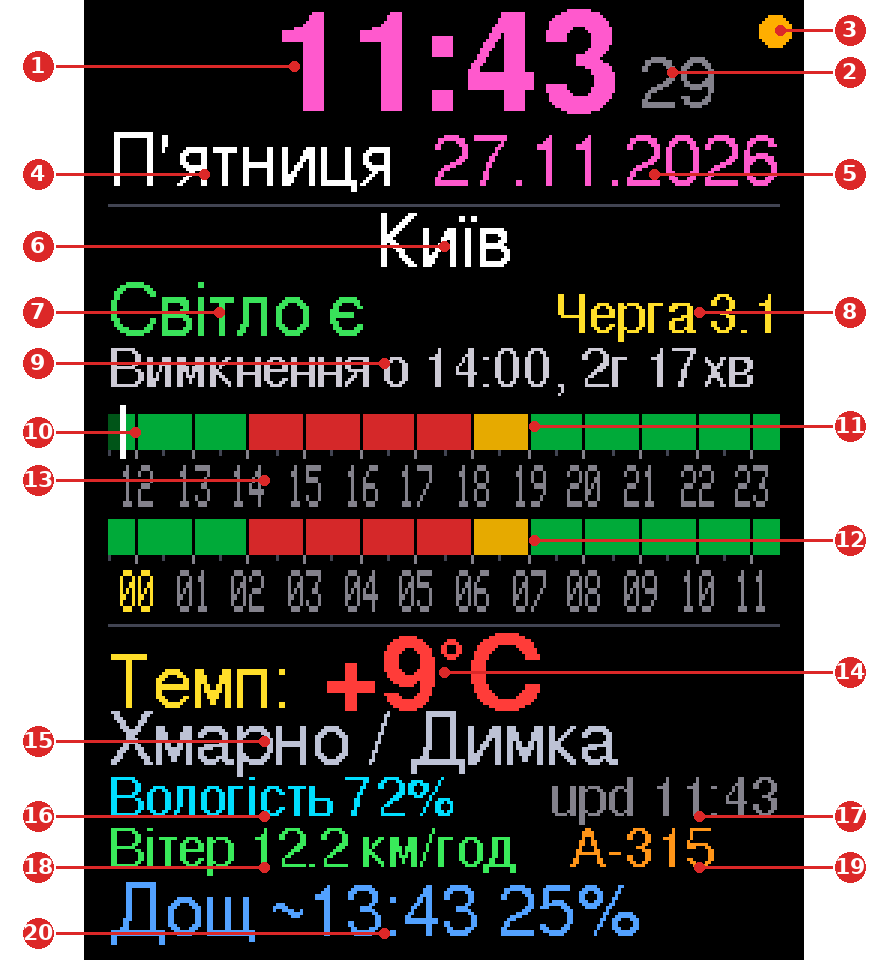

# Погодна станція + монітор відключень світла (ESP32-C3 Super Mini, TFT 2.8" 240x320 вертикально, 3 кнопки під екраном)

Екран (портрет, кнопки внизу): годинник, день тижня й дата; графік відключень на 24 години; поточна погода й прогноз опадів по годинах (Open-Meteo, без ключа). За бажання поточну погоду можна брати з OpenWeatherMap: `USE_OPENWEATHERMAP = true` і ключ `OWM_API_KEY` у `config.h`
Населений пункт обирається один раз: з нього беруться і координати для погоди, і область та черга для графіка.
Для областей без відкритих даних про графік пристрій працює як звичайна погодна станція.

 

(Ліворуч ілюстрація зібраного пристрою, праворуч головний екран.)

## 1. Підключення (докладно: `docs/wiring.png`)

| Екран (мітка на платі) | ESP32-C3 Super Mini |
|---|---|
| GND (вивід 1) | GND |
| VCC (вивід 2) | 3V3 (можна й 5V: на модулі є стабілізатор) |
| SCK (3) | GPIO4 |
| SDA (4) | GPIO6 (це лінія даних SPI, не I2C) |
| RST (5) | GPIO3 |
| DC (6) | GPIO5 |
| CS (7) | GPIO7 |

Кнопки (одним виводом на GPIO, другим на GND, підтяжка внутрішня):

| Кнопка | GPIO | Дія |
|---|---|---|
| Ліва | GPIO0 | вгору / попередній символ |
| Центральна | GPIO1 | підтвердження, на головному екрані відкриває меню (без утримання) |
| Права | GPIO10 | вниз / наступний символ; на головному екрані: оновити дані зараз |

Піни змінюються в `config.h`. Не використовуйте для кнопок GPIO2, 8, 9 (strapping) та 20, 21 (UART).

**Підсвітка.** На 7-контактному модулі окремого виводу підсвітки немає (вона завжди ввімкнена),
тому яскравість регулюється програмно: затемнюються всі кольори інтерфейсу. Якщо ви допаяєте керування
підсвіткою через транзистор до вільного піна, впишіть його в `PIN_TFT_BL` (`config.h`),
і яскравість стане справжнім ШІМ-регулюванням.

## 2. Збірка

1. Arduino IDE з ядром **esp32** (Espressif), плата **ESP32C3 Dev Module**.
2. Бібліотеки: **Adafruit GFX**, **Adafruit ST7735 and ST7789 Library**, **ArduinoJson 7.x**.
   (Якщо у вас контролер ILI9341: поставте бібліотеку **Adafruit ILI9341** і `TFT_DRIVER_ILI9341 1` у `config.h`.)
3. **Tools → Partition Scheme → Huge APP (3MB No OTA/1MB SPIFFS).** Обов'язково: база з 29 706 населених пунктів і координат займає ~470 КБ.
4. **USB CDC On Boot: Enabled** (для Serial Monitor).
5. Відкрийте `ua_weather_outage_station.ino` і завантажте на плату.

Якщо екран білий / порожній / у «снігу», пробуйте в `config.h`: `TFT_SPI_MODE` (SPI_MODE0, SPI_MODE2, SPI_MODE3), нижчу `TFT_SPI_HZ` (20000000), інший `TFT_DRIVER_ILI9341`.
Кольори «негативні»: змініть `TFT_INVERT` (0 або 1). Зображення догори дном: `TFT_ROTATION` = 0 (за замовчуванням 2).

## 3. Перший запуск

Відкриється майстер: **мережа Wi-Fi → пароль → часовий пояс → область → район → населений пункт → (оператор) → черга**.
Усе запам'ятовується; далі пристрій стартує одразу. Повторно весь майстер: утримуйте **ліву й праву** кнопки під час вмикання.

## 4. Керування

* Ліва/права: вибір (на екрані підказка «Л: вгору Ц: ОК П: вниз») (утримання дає автоповтор, довгі списки гортаються швидко). Центр: підтвердження.
* **Введення тексту** (пароль Wi-Fi, пошук пункту): унизу смуга символів, обраний посередині великий, а праворуч і ліворуч видно наступні й попередні літери.
  Ліва/права кнопка (коротко): попередній/наступний символ. Центральна (коротко): ввести обраний символ. **Утримання центральної (1 с): підтвердити введене** (пароль від 8 символів, пошук від 2 літер).
  **Велика літера:** утримуйте ліву або праву кнопку (1 с, `BTN_LONG_MS` у `config.h`): під смугою заповнюється смужка, і обрана літера стає великою (утримайте ще раз: знову малою). Велика літера діє лише для одного символу: після вводу або переходу до іншого символу знову малі. Так само і в паролі, і в пошуку (в пошуку регістр не впливає на результат).
  Службові пункти на початку смуги: **<-** (стерти останній символ), **X** (вихід без змін).
  Для пароля доступні малі й великі латинські літери, цифри та символи **@ _ - #**.

    

  (Пароль: обрана літера малою; та сама літера після утримання лівої/правої кнопки; введення назви для пошуку.)
* **Меню** (центральна на головному екрані): населений пункт і черга, Wi-Fi, часовий пояс, **яскравість**, оновити дані, назад.

    

  (Меню налаштувань, приклад списку, панель яскравості.)

* **Яскравість**: показується основний екран, унизу панель. Ліва темніше, права яскравіше, центральна підтверджує й зберігає (без дій 30 с: автовихід).
* **Опади**: прогноз по годинах на 24 години вперед (Open-Meteo); показується перша година з ймовірністю від 20 % (`POP_THRESHOLD` у `config.h`). Безкоштовний прогноз OpenWeatherMap має лише 3-годинний крок, тому опади завжди йдуть з Open-Meteo.

## 5. Екран

Згори вниз: **час**; **день тижня** (зліва) і **дата** (справа); лінія; **назва пункту**, стан світла, наступна подія,
«через…» і **черга**, графік на 24 години двома смугами по 12 годин (кожна смуга починається й закінчується позначкою пів години, тому підписи годин стоять рівномірно; зліва видно до години минулого, воно притемнене): під кожною годиною мітка з підписом, під пів-годиною мітка без підпису (зелений світло є, червоний немає, жовтий можливе відключення, білий маркер «зараз»); лінія;
**Темп:** і температура, стан погоди, вологість, вітер (швидкість зеленим, азимут оранжевим), опади.
Кружок у куті: зелений усе гаразд, жовтий дані застаріли або помилка, червоний немає Wi-Fi.

(Цифри: 1 час, 2 секунди, 3 індикатор стану, 4 день тижня, 5 дата, 6 назва пункту, 7 стан світла, 8 черга, 9 наступна подія, 10 маркер «зараз», 11 і 12 смуги графіка, 13 підписи годин, 14 температура, 15 стан погоди, 16 вологість, 17 час оновлення погоди, 18 швидкість вітру, 19 азимут, 20 опади.)

## 6. База населених пунктів

`places_data.h` згенеровано з `ukr-populated-places.xlsx` (COD-AB Україна, OCHA/HDX, CC BY-IGO) скриптом `tools/gen_places.py`:
для кожного пункту є область, район, громада та координати. Оновлення: `python tools/gen_places.py ukr-populated-places.xlsx places_data.h` (потрібен `openpyxl`).

## 7. Джерела графіків

Див. `sources.h` (відкриті дані обленерго). Для областей без відкритого джерела пункт зберігається у режимі «лише погода».

## 8. Діагностика

Serial Monitor (115200) при запуску друкує причину скидання (`причина скидання: ...`), а після кожного оновлення даних вільну пам'ять.
Якщо весь екран раптово блимає, перевірте, чи з'являється новий рядок «Запуск»: це означає перезавантаження плати.
Швидкість SPI за замовчуванням 20 МГц (`TFT_SPI_HZ` у `config.h`); на довгих дротах 40 МГц може давати збої.
